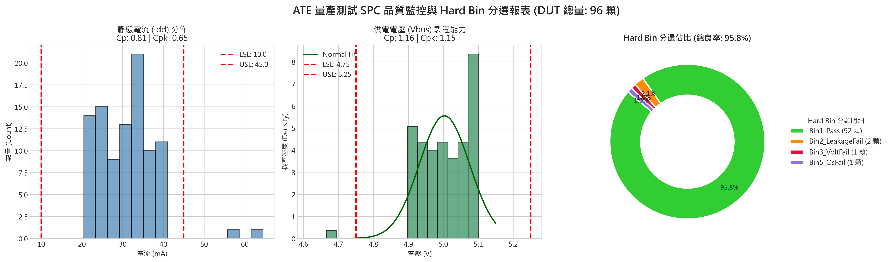

# Semiconductor ATE Host Controller & Automated SPC Quality Pipeline

[](https://dotnet.microsoft.com/)
[](https://www.python.org/)
[]()

本專案模擬半導體後段封裝測試（Final Test / ATE）之量測控制與統計製程管制（SPC）架構。  
系統前端採用 **C# Windows Forms** 開發非阻塞（Non-blocking）自動化人機介面（HMI），實作批次排程量測、治具保護（Open/Short Check）與符合工安標準的 **EMO（緊急煞停）** 狀態機；後端利用 **Python + Pandas / SciPy / Matplotlib** 建立 ETL 日誌清洗與 SPC 分析管線，自動計算製程能力指標（Cp / Cpk）並輸出工業級監控儀表板。

---

## 系統架構與設計核心 (System Architecture)

```mermaid
flowchart LR
    subgraph Host["ATE Test Host (C# WinForms)"]
        direction LR
        A["Start&nbsp;Test"] --> B["Contact&nbsp;Check:&nbsp;Open/Short&nbsp;@&nbsp;-100uA"]
        B -- Fail --> B5["Fast&nbsp;Abort:&nbsp;Bin&nbsp;5&nbsp;Fixture&nbsp;Protection"]
        B -- Pass --> C["DC&nbsp;Parametric:&nbsp;Idd&nbsp;&amp;&nbsp;Vbus"]
        C --> D["Hard&nbsp;Binning&nbsp;Classifier:&nbsp;Bin&nbsp;1~4"]
        D --> E["Log&nbsp;Dispatcher:&nbsp;LSL&nbsp;/&nbsp;USL&nbsp;/&nbsp;Meas"]
        B5 --> E
    end

    subgraph Storage["Storage"]
        F[("TestLogs&nbsp;Directory")]
    end

    subgraph Analytics["SPC Data Pipeline (Python)"]
        direction LR
        G["Regex&nbsp;Log&nbsp;Parser&nbsp;&amp;&nbsp;Anomaly&nbsp;Handling"]
        H["SPC&nbsp;Engine:&nbsp;Mean,&nbsp;Std,&nbsp;Cp,&nbsp;Cpk"]
        I["Quality&nbsp;Dashboard&nbsp;(Matplotlib&nbsp;/&nbsp;Seaborn)"]
        G --> H --> I
    end

    E --> F
    F --> G

    style Host fill:#1e293b,stroke:#38bdf8,stroke-width:2px,color:#fff
    style Analytics fill:#1e293b,stroke:#34d399,stroke-width:2px,color:#fff
    style Storage fill:#334155,stroke:#94a3b8,stroke-width:2px,color:#fff
    style B5 fill:#dc2626,stroke:#f87171,color:#fff
```

---

## 核心功能特色 (Key Features)

### 1. C# ATE Host Controller (前端人機與機台控制)
- **非同步排程架構（Async/Await）**：UI 主執行緒與量測任務完全解耦，批次連續測試不卡頓。
- **治具與探針保護（Open/Short Check）**：於通電前先行量測保護二極體順向壓降；若接觸不良（Open）或短路（Short），系統立即阻斷主供電並分選為 `Bin 5`，預防治具燒毀。
- **EMO 安全狀態機（Emergency Off）**：整合 `CancellationTokenSource`，作業員觸發急停鍵時能在 10ms 內安全中止迴圈，並保證中斷前的已測數據完整落地歸檔。
- **標準化測試日誌輸出**：自動將每顆晶片量測數據格式化輸出為含有 SPEC 上下限（USL / LSL）、量測數值與 Hard Bin 標籤之文字 Log。

2. Python SPC Analytics Pipeline (後端品管分析)
- 日誌解析與異常清洗（ETL Pipeline）：使用正規表達式（Regex）批次解析 .log 檔案；自動將被 OS 阻斷之無效數值（0V / 0mA）填補為 NaN，確保統計分佈真實性。
- 製程能力評估（Process Capability Analysis）：
  $$Cp = \frac{USL - LSL}{6\sigma}, \quad Cpk = \min\left(\frac{USL - \mu}{3\sigma}, \frac{\mu - LSL}{3\sigma}\right)$$
- 3-in-1 品質監控儀表板：
  - 靜態電流 (Idd) 直方圖：檢視漏電流偏態與離群值。
  - 供電電壓 (Vbus) 常態擬合曲線：評估製程中心是否偏移與分佈收斂性。
  - 失效項目柏拉圖分析（Defect Pareto Chart）：採用雙 Y 軸架構（缺陷計數 ＋ 累積百分比折線），排除 Pass 樣本，專注鎖定 80% 良率損失之關鍵失效模式（Hard Bin），作為產線改善第一優先級。
---

## Hard Binning 分選定義 (Bin Map)

| Bin Code | 分選名稱 | 測試判定條件 | 處置方式 |
| :---: | :--- | :--- | :--- |
| **Bin 1** | `Bin1_Pass` | OS, Idd, Vbus 全數符合規範 | 良品出貨 (PASS) |
| **Bin 2** | `Bin2_LeakageFail` | 待機電流超標 ($Idd > 45\,\text{mA}$) | 靜態功耗不良 |
| **Bin 3** | `Bin3_VoltFail` | 供電電壓塌陷 ($Vbus < 4.75\,\text{V}$) | 供電壓降異常 |
| **Bin 4** | `Bin4_TotalFail` | Idd 與 Vbus 皆異常 | 重大直流缺陷 |
| **Bin 5** | `Bin5_OsFail` | 二極體壓降超出 $-0.90\text{V} \sim -0.20\text{V}$ | 治具/接觸異常，阻斷供電 |

---

## 報表產出展示 (Dashboard Preview)

產線批次測試完成後，執行分析腳本將自動產出 300 DPI 工業級品管圖表：



---

## 快速開始 (Getting Started)

### 需求環境
- **C#**：.NET 6.0 / .NET Framework 4.8+, Visual Studio 2022
- **Python**：Python 3.8+

### 步驟 1：編譯並執行 C# 機台介面
1. 使用 Visual Studio 開啟專案並執行。
2. 點擊 **「⚡ 批次自動 (50顆)」** 開始模擬測試。
3. 測試日誌將自動寫入專案目錄下的 `TestLogs/` 資料夾。

### 步驟 2：執行 Python SPC 儀表板分析
```bash
# 安裝所需
pip install numpy pandas matplotlib scipy

# 執行分析腳本 (自動讀取 TestLogs/ 並產出儀表板圖表)
python v2_spc_analysis.py
